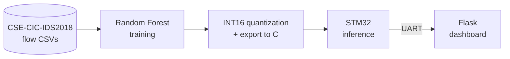
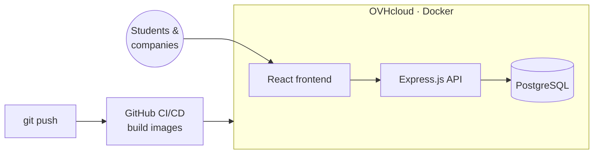
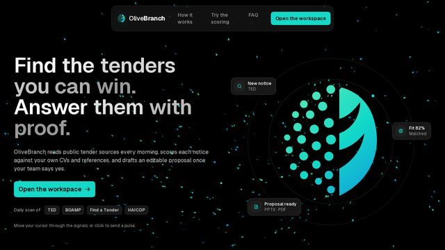

<div align="center">

<picture>
  <source media="(prefers-color-scheme: dark)" srcset="assets/header.svg" />
  <source media="(prefers-color-scheme: light)" srcset="assets/header-light.svg" />
  
</picture>

[](https://www.linkedin.com/in/mohamed-firas-berriri-287b06337/)
[](mailto:mohamedfiras.berriri@etudiant-enit.utm.tn)
[](#-connect---pfe-2027)

</div>

### `$ cat profile.yaml`

```yaml
apiVersion: v1
kind: Engineer
metadata:
  name: mohamed-firas-berriri
  location: tunisia
spec:
  school: ENIT — Telecommunications Engineering, Cloud specialization (2024–2027)
  focus: [kubernetes, docker, ci-cd, ai-automation, tinyml]
  languages: { arabic: native, french: fluent, english: B2, german: A2 }
status:
  phase: Seeking
  lookingFor: 6-month PFE · from February 2027 · Cloud / DevOps / MLOps
```

### `$ traceroute pfe-2027`

```text
traceroute to your-company (?.?.?.?), 6 hops max
 1  ipei-monastir.prepa      2022–2024   ✓  maths & physics
 2  enit.telecom.cloud       2024–2027   ✓  engineering degree
 3  l2t.sousse.k8s           Jun 2025    ✓  multi-node Kubernetes · Kubespray · Ansible
 4  actia.pfa2.tinyml        2025–2026   ✓  IDS on STM32 · 87.25% acc · ~1 KB RAM
 5  draxlmaier.automation    Jul 2026    ✓  badge workflow · adopted in production
 6  * * *  your-company                  ←  PFE · February 2027
```

<details>
<summary><code>$ kubectl describe experience</code></summary>
<br>

**DRÄXLMAIER Group (METS)** — Process Automation Intern · *Jul–Aug 2026*<br>
Designed and deployed a visitor & intern badge workflow — Microsoft Forms → SharePoint → Power Automate → Word → Outlook — centralizing records, badge generation, status tracking and email notifications. **Adopted by the company.**

**ACTIA Engineering Services** — Year-End Project (PFA2) · *Dec 2025–May 2026*<br>
TinyML network intrusion detector: Random Forest trained on CSE-CIC-IDS2018, quantized to INT16 and running in C on an STM32 — **87.25 % accuracy, ~100 KB flash, ~1 KB RAM**.

**L2T, Sousse** — Cloud Infrastructure Intern · *Jun–Jul 2025*<br>
Deployed and configured multi-node Kubernetes clusters with Kubespray and Ansible; Docker for containerized workloads, Lens for cluster management.

</details>

### `$ kubectl get projects`

```text
NAME             STATUS      STACK                                   NOTES
enit-connect     Running     React · Express · PostgreSQL · Docker   deployed on OVHcloud via GitHub CI/CD
nids-tinyml      Completed   Python · Random Forest · C · STM32      87.25% accuracy in ~1 KB RAM
ai-assistant     Running     n8n · Groq · Telegram · WhatsApp        email & calendar by natural language
utopia-hire      Completed   Python · pdfplumber · NLTK              IEEE TSYP 13 · pitched at CSTAM
sakina           Completed   Flutter · RAG                           emotion-aware Quranic guidance
easy-nmap        Running     Python · Nmap · LLM                     Nmap made easier with AI
```

<details>
<summary><code>$ kubectl describe project nids-tinyml</code></summary>
<br>

Trains a network-flow classifier on CSE-CIC-IDS2018, exports the Random Forest to C, and evaluates STM32 predictions over UART, with a local Flask dashboard. → [repo](https://github.com/Firas-eng-hub/NIDS-TinyML)



</details>

<details>
<summary><code>$ kubectl describe project enit-connect</code></summary>
<br>

ENIT career platform connecting students, companies and administrators. I built the React frontend and deployed the stack on OVHcloud with Docker and GitHub CI/CD. → [repo](https://github.com/Firas-eng-hub/Enit_Connect)



</details>

<details>
<summary><code>$ kubectl describe project ai-assistant utopia-hire sakina easy-nmap</code></summary>
<br>

- **AI Workflow Assistant** — assistant on Telegram and WhatsApp that executes natural-language email and scheduling requests through Gmail and Google Calendar tools (n8n + Groq API).
- **UtopiaHire** — CV parsing and skills-extraction pipeline for an AI recruitment platform with job matching and interview simulation; selected to pitch at CSTAM (IEEE TSYP 13). → [repo](https://github.com/Firas-eng-hub/Utopia)
- **Sakina** — Flutter app using retrieval-augmented generation to surface Quranic verses matching the emotion you express. *(private repo)*
- **EasyNmap** — AI layer that makes Nmap easier to drive. → [repo](https://github.com/Firas-eng-hub/EasyNmap)

</details>

### `$ curl -sI` — live deployments

<table>
  <tr>
    <td colspan="2" align="center">
      <a href="https://olivesoft-lime.vercel.app"></a><br>
      <code>200 OK</code> <b>OliveBranch</b> — RFP intelligence: scans public tenders daily, scores them against internal CVs &amp; references, drafts an editable PPTX/PDF proposal<br>
      <sub><a href="https://olivesoft-lime.vercel.app">live</a> · private repo</sub>
    </td>
  </tr>
  <tr>
    <td width="50%" valign="top">
      <a href="https://optical-power-budget-simulator.vercel.app"></a><br>
      <code>200 OK</code> <b>Optical Lab</b> — fiber-link power budget, dispersion &amp; max reach<br>
      <sub><a href="https://optical-power-budget-simulator.vercel.app">live</a> · <a href="https://github.com/Firas-eng-hub/Optical-power-budget-simulator">source</a></sub>
    </td>
    <td width="50%" valign="top">
      <a href="https://lo-l-assistant.vercel.app"></a><br>
      <code>200 OK</code> <b>LaneForge</b> — matchup build assistant<br>
      <sub><a href="https://lo-l-assistant.vercel.app">live</a> · <a href="https://github.com/Firas-eng-hub/LoL-assistant">source</a></sub>
    </td>
  </tr>
  <tr>
    <td width="50%" valign="top">
      <a href="https://coffee-3-d.vercel.app"></a><br>
      <code>200 OK</code> <b>Frappuccino Atelier</b> — 3D scroll-animated brand site<br>
      <sub><a href="https://coffee-3-d.vercel.app">live</a> · <a href="https://github.com/Firas-eng-hub/Coffee-3D">source</a></sub>
    </td>
    <td width="50%" valign="top">
      <a href="https://mercedes-lux.vercel.app"></a><br>
      <code>200 OK</code> <b>S-Class Showcase</b> — cinematic product landing page<br>
      <sub><a href="https://mercedes-lux.vercel.app">live</a> · <a href="https://github.com/Firas-eng-hub/Mercedes-Website">source</a></sub>
    </td>
  </tr>
</table>

### `$ helm list -A` — stack

| Namespace | Tools |
|---|---|
| **cloud-devops** |        |
| **ai-automation** |       |
| **development** |       |
| **network-ms365** |      |

### `$ ls ~/certs ~/leadership`

```text
certs/
  fundamentals-of-mlops            KodeKloud               2026
  ccna-introduction-to-networks    Cisco / ENIT            2025
  efficient-llm-customization      NVIDIA / DeepLearning   2024

leadership/
  treasurer                        IEEE Computer Society Chapter · ENIT SB
  organizer                        IEEEXtreme · WIEAct · IEEE LUMEN
  pitch                            UtopiaHire @ CSTAM · IEEE TSYP 13
```

### `$ git log -5` — recently pushed
<sub>Refreshed daily by a GitHub Action.</sub>

<!-- RECENT:START -->
| Repository | Description | Language | Last push |
|---|---|---|---|
| [Enit_Connect](https://github.com/Firas-eng-hub/Enit_Connect) | TIC-Connect is a full-stack web platform designed to connect students, companies, and a… | `HTML` | 2026-11-16 |
| [Olivesoft-Pres](https://github.com/Firas-eng-hub/Olivesoft-Pres) | Olivesoft presentation | `JavaScript` | 2026-11-12 |
| [NIDS-TinyML](https://github.com/Firas-eng-hub/NIDS-TinyML) | A research prototype for training a network-flow classifier on CSE-CIC-IDS2018 CSVs, ex… | `Python` | 2026-11-10 |
| [Portfolio](https://github.com/Firas-eng-hub/Portfolio) | — | `JavaScript` | 2026-10-19 |
| [Utopia](https://github.com/Firas-eng-hub/Utopia) | Your career guide | `Python` | 2026-10-18 |
<!-- RECENT:END -->

### `$ top` — activity

<div align="center">


<picture>
  <source media="(prefers-color-scheme: dark)" srcset="https://raw.githubusercontent.com/Firas-eng-hub/Firas-eng-hub/output/github-contribution-grid-snake-dark.svg" />
  <source media="(prefers-color-scheme: light)" srcset="https://raw.githubusercontent.com/Firas-eng-hub/Firas-eng-hub/output/github-contribution-grid-snake.svg" />
  
</picture>

</div>

<details>
<summary><code>$ export LANG=fr_FR.UTF-8</code> — version française</summary>
<br>

**Mohamed Firas Berriri** — élève ingénieur en dernière année de Télécommunications à l'**ENIT**, spécialité Cloud.<br>
Je recherche un **PFE de 6 mois à partir de février 2027** en **Cloud, DevOps ou MLOps**.

- **DRÄXLMAIER Group (METS)** — Stage automatisation des processus · juil.–août 2026 : workflow de gestion des badges visiteurs et stagiaires (Forms, SharePoint, Power Automate, Word, Outlook), adopté par l'entreprise.
- **ACTIA Engineering Services** — PFA2 · déc. 2025–mai 2026 : détecteur d'intrusions réseau TinyML (Random Forest, CSE-CIC-IDS2018) quantifié en INT16 sur STM32 — **87,25 %** de précision, ~100 Ko de flash, ~1 Ko de RAM.
- **L2T, Sousse** — Stage infrastructure cloud · juin–juil. 2025 : déploiement de clusters Kubernetes multi-nœuds avec Kubespray, Ansible et Docker.

**Projets** — EnitConnect (React, Docker, CI/CD GitHub, OVHcloud) · Assistant IA n8n + Groq (Telegram, WhatsApp) · UtopiaHire (IEEE TSYP 13, pitch au CSTAM) · Sakina (Flutter + RAG).

</details>

### `$ ./connect --pfe 2027`

<div align="center">

[](https://www.linkedin.com/in/mohamed-firas-berriri-287b06337/)
[](mailto:mohamedfiras.berriri@etudiant-enit.utm.tn)

</div>
