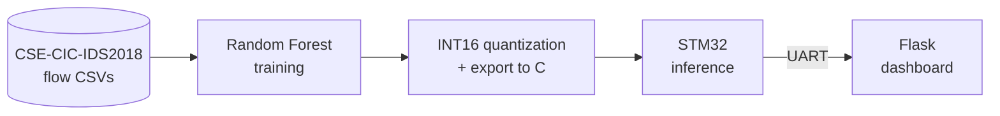
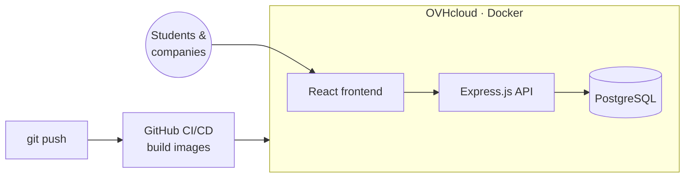
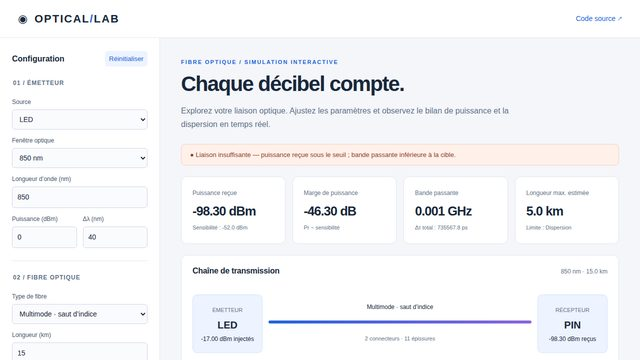
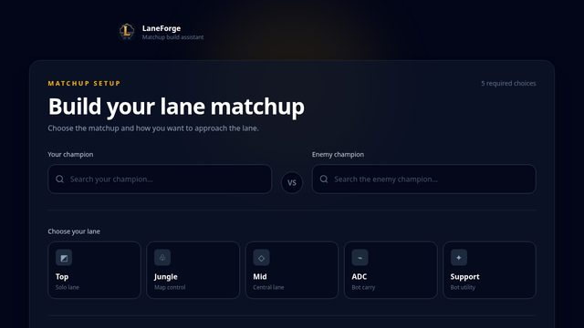
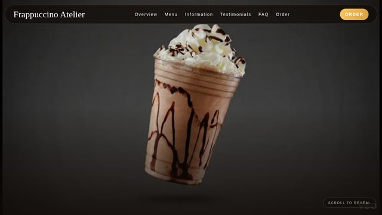

<div align="center">

<picture>
  <source media="(prefers-color-scheme: dark)" srcset="assets/title.svg" />
  <source media="(prefers-color-scheme: light)" srcset="assets/title-light.svg" />
  
</picture>

### ⚔️ NEW QUEST AVAILABLE ⚔️
**Seeking a 6-month PFE (end-of-studies internship) from February 2027 — Cloud · DevOps · MLOps**

[](https://www.linkedin.com/in/mohamed-firas-berriri-287b06337/)
[](mailto:mohamedfiras.berriri@etudiant-enit.utm.tn)


</div>

---

## 🧙 Character Sheet

| | |
|---|---|
| **Player** | Mohamed Firas Berriri |
| **Class** | Cloud & DevOps Engineer *(subclass: AI Automation)* |
| **Guild** | ENIT — École Nationale d'Ingénieurs de Tunis · Telecommunications, Cloud specialization |
| **Origin** | Tunisia 🇹🇳 |
| **Level** | Final-year engineering student · `XP ██████████████████░░ 90%` → graduation 2027 |
| **Spoken spells** | Arabic (native) · French (fluent) · English (B2) · German (A2) |
| **Status** | 🟢 Looking for a party — PFE Feb 2027 |

## 📊 Stats

```text
KUBERNETES / DOCKER   ████████░░   Cluster tamer — Kubespray, Ansible, Lens
CI/CD                 ███████░░░   GitHub Actions → Docker → OVHcloud
AI AUTOMATION         ████████░░   n8n, Groq API, RAG, NLP
TINYML / EMBEDDED C   ███████░░░   Random Forest → C → STM32
WEB (REACT / TS)      ███████░░░   React, TypeScript, Express, PostgreSQL
NETWORKING            ███████░░░   TCP/IP, IPv4/IPv6, CCNA ITN
POWER PLATFORM        ██████░░░░   Power Automate, SharePoint, M365
```

---

## 🗺️ Quest Log

> ✅ **Lv 1 — Tutorial Island** · *IPEI Monastir · 2022–2024*<br>
> Preparatory studies in mathematics & physics. Unlocked: **ENIT**.

> ✅ **Quest: Tame the Cluster** · *L2T, Sousse — Cloud Infrastructure Intern · Jun–Jul 2025*<br>
> Deployed and configured multi-node **Kubernetes** clusters with **Kubespray** and **Ansible**; ran containerized workloads with **Docker** and managed them with **Lens**.<br>
> 🎁 *Reward:* `+ Kubernetes` `+ Infrastructure as Code`

> ✅ **⚔️ Boss Fight: An IDS in 1 KB of RAM** · *ACTIA Engineering Services — PFA2 · Dec 2025–May 2026*<br>
> Built a TinyML network intrusion detector (Random Forest, CSE-CIC-IDS2018), quantized to INT16 and running in C on an **STM32**.
>
> | 🎯 Accuracy | 💾 Flash | 🧠 RAM |
> |:---:|:---:|:---:|
> | **87.25 %** | **~100 KB** | **~1 KB** |

> ✅ **Side Quest: Automate the Badges** · *DRÄXLMAIER Group (METS) — Process Automation Intern · Jul–Aug 2026*<br>
> Designed and deployed a visitor & intern badge workflow — **Microsoft Forms → SharePoint → Power Automate → Word → Outlook** — centralizing records, badge generation, status tracking and notifications.<br>
> 🎁 *Reward:* **adopted by the company** 🏅

> ⏳ **Current Quest: PFE — February 2027 (6 months)**<br>
> Cloud · DevOps · MLOps. **Looking for a party to join →** [LinkedIn](https://www.linkedin.com/in/mohamed-firas-berriri-287b06337/) · [Email](mailto:mohamedfiras.berriri@etudiant-enit.utm.tn)

---

## 🏰 Dungeons Cleared

<details>
<summary><b>🛰️ NIDS-TinyML</b> — intrusion detection on a microcontroller</summary>
<br>

Trains a network-flow classifier on CSE-CIC-IDS2018, exports the Random Forest to C, and evaluates STM32 predictions over UART, with a local Flask dashboard for PC or device events.

**Loot:** `Python` `scikit-learn` `C` `STM32` `Flask` · [**Enter dungeon →**](https://github.com/Firas-eng-hub/NIDS-TinyML)



</details>

<details>
<summary><b>🎓 EnitConnect</b> — ENIT career platform, built & deployed</summary>
<br>

Career platform connecting students, companies and administrators: networking, internship/job offers and document sharing. I built the **React frontend** and **deployed** the stack on OVHcloud with Docker and GitHub CI/CD.

**Loot:** `React` `Express.js` `PostgreSQL` `Docker` `GitHub Actions` `OVHcloud` · [**Enter dungeon →**](https://github.com/Firas-eng-hub/Enit_Connect)



</details>

<details>
<summary><b>🤖 AI Workflow Assistant</b> — talk to your inbox and calendar</summary>
<br>

An AI assistant on **Telegram** and **WhatsApp** that executes natural-language email and scheduling requests through Gmail and Google Calendar tools.

**Loot:** `n8n` `Groq API` `Telegram` `WhatsApp` `Gmail` `Google Calendar`

</details>

<details>
<summary><b>🧭 UtopiaHire</b> — AI recruitment · IEEE TSYP 13</summary>
<br>

CV parsing and skills-extraction pipeline for an AI recruitment platform with job matching and interview simulation. **Selected to pitch at CSTAM.**

**Loot:** `Python` `pdfplumber` `NLTK` · [**Enter dungeon →**](https://github.com/Firas-eng-hub/Utopia)

</details>

<details>
<summary><b>🌙 Sakina</b> — emotion-aware Quranic guidance</summary>
<br>

Mobile app using retrieval-augmented generation to find Quranic verses that match the emotion you express, and deliver personalized spiritual guidance.

**Loot:** `Flutter` `RAG` · *private repo*

</details>

<details>
<summary><b>🔎 EasyNmap</b> — Nmap, made easier with AI</summary>
<br>

**Loot:** `Python` `Nmap` `LLM` · [**Enter dungeon →**](https://github.com/Firas-eng-hub/EasyNmap)

</details>

---

## 🕹️ Arcade — insert coin to play

<table>
  <tr>
    <td align="center" width="50%">
      <a href="https://optical-power-budget-simulator.vercel.app"></a>
      <b>Optical Lab</b><br><sub>Fiber-link simulator: power budget, dispersion, max reach</sub><br>
      <a href="https://optical-power-budget-simulator.vercel.app">▶ PLAY</a> · <a href="https://github.com/Firas-eng-hub/Optical-power-budget-simulator">source</a>
    </td>
    <td align="center" width="50%">
      <a href="https://lo-l-assistant.vercel.app"></a>
      <b>LaneForge</b><br><sub>Matchup build assistant for League of Legends</sub><br>
      <a href="https://lo-l-assistant.vercel.app">▶ PLAY</a> · <a href="https://github.com/Firas-eng-hub/LoL-assistant">source</a>
    </td>
  </tr>
  <tr>
    <td align="center" width="50%">
      <a href="https://coffee-3-d.vercel.app"></a>
      <b>Frappuccino Atelier</b><br><sub>Coffee brand site with 3D scroll animation</sub><br>
      <a href="https://coffee-3-d.vercel.app">▶ PLAY</a> · <a href="https://github.com/Firas-eng-hub/Coffee-3D">source</a>
    </td>
    <td align="center" width="50%">
      <a href="https://mercedes-lux.vercel.app"></a>
      <b>S-Class Showcase</b><br><sub>Cinematic luxury car landing page</sub><br>
      <a href="https://mercedes-lux.vercel.app">▶ PLAY</a> · <a href="https://github.com/Firas-eng-hub/Mercedes-Website">source</a>
    </td>
  </tr>
</table>

---

## 🎒 Inventory

**⚔️ Weapons — Cloud & DevOps**


**🔮 Spells — AI & Automation**


**🛠️ Tools — Development**


**🛡️ Armor — Networking & Microsoft**


---

## 🏆 Achievements Unlocked

| | Achievement | |
|:---:|---|---|
| 🎤 | **Pitched at CSTAM** | UtopiaHire, IEEE TSYP 13 competition |
| 💰 | **Treasurer** | IEEE Computer Society Chapter, ENIT Student Branch |
| 🎪 | **Event organizer** | IEEEXtreme · WIEAct · IEEE LUMEN |
| 📜 | **Fundamentals of MLOps** | KodeKloud · 2026 |
| 📜 | **CCNA: Introduction to Networks** | Cisco / ENIT · 2025 |
| 📜 | **Efficient LLM Customization** | NVIDIA / DeepLearning.AI · 2024 |

---

## 💾 Recent Saves
<sub>Auto-updated daily by a GitHub Action.</sub>

<!-- RECENT:START -->
| Save slot | Description | Lang | Last saved |
|---|---|---|---|
| 💾 [Enit_Connect](https://github.com/Firas-eng-hub/Enit_Connect) | TIC-Connect is a full-stack web platform designed to connect students, companies, and a… | `HTML` | 2026-11-16 |
| 💾 [Olivesoft-Pres](https://github.com/Firas-eng-hub/Olivesoft-Pres) | Olivesoft presentation | `JavaScript` | 2026-11-12 |
| 💾 [NIDS-TinyML](https://github.com/Firas-eng-hub/NIDS-TinyML) | A research prototype for training a network-flow classifier on CSE-CIC-IDS2018 CSVs, ex… | `Python` | 2026-11-10 |
| 💾 [Portfolio](https://github.com/Firas-eng-hub/Portfolio) | — | `JavaScript` | 2026-10-19 |
| 💾 [Utopia](https://github.com/Firas-eng-hub/Utopia) | Your career guide | `Python` | 2026-10-18 |
<!-- RECENT:END -->

---

## 📈 Player Stats

<div align="center">


<picture>
  <source media="(prefers-color-scheme: dark)" srcset="https://raw.githubusercontent.com/Firas-eng-hub/Firas-eng-hub/output/github-contribution-grid-snake-dark.svg" />
  <source media="(prefers-color-scheme: light)" srcset="https://raw.githubusercontent.com/Firas-eng-hub/Firas-eng-hub/output/github-contribution-grid-snake.svg" />
  
</picture>

</div>

---

<details>
<summary><b>🇫🇷 Version française</b></summary>
<br>

**Mohamed Firas Berriri** — élève ingénieur en dernière année de Télécommunications à l'**ENIT**, spécialité Cloud.<br>
Je recherche un **PFE de 6 mois à partir de février 2027** en **Cloud, DevOps ou MLOps**.

**Parcours**
- **DRÄXLMAIER Group (METS)** — Stage automatisation des processus · juil.–août 2026 : workflow de gestion des badges visiteurs et stagiaires (Forms, SharePoint, Power Automate, Word, Outlook), adopté par l'entreprise.
- **ACTIA Engineering Services** — PFA2 · déc. 2025–mai 2026 : détecteur d'intrusions réseau TinyML (Random Forest, CSE-CIC-IDS2018) quantifié en INT16 sur STM32 — **87,25 %** de précision, ~100 Ko de flash, ~1 Ko de RAM.
- **L2T, Sousse** — Stage infrastructure cloud · juin–juil. 2025 : déploiement de clusters Kubernetes multi-nœuds avec Kubespray, Ansible et Docker.

**Projets** — EnitConnect (React, Docker, CI/CD GitHub, OVHcloud) · Assistant IA n8n + Groq (Telegram, WhatsApp) · UtopiaHire (IEEE TSYP 13, pitch au CSTAM) · Sakina (Flutter + RAG).

**Contact** — [LinkedIn](https://www.linkedin.com/in/mohamed-firas-berriri-287b06337/) · [mohamedfiras.berriri@etudiant-enit.utm.tn](mailto:mohamedfiras.berriri@etudiant-enit.utm.tn)

</details>

---

<div align="center">

```text
╔══════════════════════════════════════════╗
║            G A M E   O V E R ?           ║
║                                          ║
║     ▶ CONTINUE  — PFE · February 2027    ║
║       QUIT                               ║
╚══════════════════════════════════════════╝
```

[](https://www.linkedin.com/in/mohamed-firas-berriri-287b06337/)
[](mailto:mohamedfiras.berriri@etudiant-enit.utm.tn)

</div>
